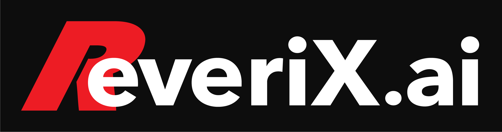

# AiteEcho · 艾特回声

## 推广｜Reverix AI 中转服务

### [前往 Reverix AI → love.reverix.ai](https://love.reverix.ai)

**广告／代理关系说明：** 此入口由项目维护者 ilovvveu 以代理身份推广，并非中立推荐或模型厂商官方入口。是否使用完全自愿，AiteEcho 不绑定该站点，仍可自行配置其他兼容 API。

模型、价格、额度、可用性及数据处理规则请以服务方当前说明为准；本项目不据此承诺最低价、持续可用或云端零留存。品牌标识相关权利归其权利人，软件 MIT 许可不授予商标权。

---

一个可自托管、可配置的QQ AI助手：@触发回应，按需理解图片/文档/引用、联网、分析近期发言，并可单次配音。

**由 [ilovvveu](https://github.com/ilovvveu) 主导持续二次开发与维护。本维护版本基于上游qq-ai-bot进行了大量修改、功能扩展和架构/安全/部署改造，不是只更换名称的原样镜像，也不宣称全部从零原创。** 原始作者及来源保留在[NOTICE](NOTICE)，主要变更见[二次开发说明](docs/derivative-changes.md)，原版权和[MIT许可](LICENSE)完整保留。

本项目不是腾讯QQ、NapCat、OpenAI或模型提供方的官方产品。推荐的独立API后端不要求Codex保持在线。当前为独立维护版本；源码开源不代表所有平台或真实客户端均已验收，本项目不提供官方镜像、API额度或在线托管服务。

## 功能一览

| 方向 | 已实现能力 | 启用与边界 |
| --- | --- | --- |
| 对话接入 | QQ群聊/私聊，OneBot 11正向/反向WS，独立Responses API，可选ACP | 群/私聊默认关闭；地址、密钥、模型、主人名单自行配置 |
| 权限与额度 | 真实@、白黑名单、主人/管理/普通/特殊分层，逐人滚动限频 | 开放群的设置与管理只给主人；模型不能自行授权 |
| 图片与文件 | 多图、macOS Vision OCR、一层同会话引用、PDF/DOCX/XLSX/文本提取 | 对应能力按需开启，有来源、大小、时限、节选与平台限制 |
| 搜索与发言分析 | 提供方hosted搜索，按人/时间/条数有界分析本群发言 | 不后台采集全群，不声称取全历史；样本会发送给模型 |
| 上下文 | 本地条数/时间/大小修剪，可选最多6轮/3000字符短历史 | 默认不带旧问答，/context由主人切换；图片/推理密文不重放 |
| 表达与风格 | 空白默认、可选43套模板、自建风格、全局规则热加载 | /style仅主人按会话切换，不固定性别/角色/音色 |
| 命令语音 | ElevenLabs单次配音、可配短答纯语音门槛、SILK转换、文字回退 | 必须命令触发；群语音另启用，独立额度并计入普通额度 |
| 可观察与运维 | 分环节诊断、可选本地@问答存档、健康/就绪/受保护状态与指标 | 默认回环；独立存档不自动清理，ACK不等于客户端验收 |

完整范围、默认值、命令、数据流与不支持项见[具体功能说明](docs/features.md)。配置入口见[自定义设置](docs/customization.md)。

## 快速开始

需要Node.js 22/24、npm，以及自行安装并获准使用的QQ/NapCat或其他OneBot 11实现。本仓库不提供QQ客户端、登录账号或API额度。

取得源码后，在根目录执行：

~~~sh
npm ci
cp .env.example .env
cp examples/group-rules.example.json examples/group-rules.local.json
~~~

在私有.env中填写：

1. AI_BACKEND=direct，兼容/responses的DIRECT_API_BASE_URL、DIRECT_API_MODEL与密钥；普通聊天网页或仅Chat Completions接口不能直接替代。
2. ONEBOT_OWNER_USERS及群/用户名单，显式开启需要的群聊/私聊；普通用户白名单不授予主人权限。
3. 独立随机ONEBOT_ACCESS_TOKEN，与NapCat一致；跨容器/非回环管理还需不同的BOT_ADMIN_TOKEN。不要沿用占位口令。
4. NapCat设置反向WS和array消息格式；本机示例地址为ws://127.0.0.1:16700/onebot/v11/ws，跨容器按[Docker说明](docs/docker-quickstart.md)设置，不照抄回环地址。

~~~sh
npm run build
npm start
~~~

先看/healthz，再看/readyz，必要时用Bearer头访问/status；不要把管理口、OneBot或NapCat WebUI裸露公网。完整步骤见[快速开始](docs/getting-started.md)。既有目录、launchd及部分变量名保留兼容，不因改名自动迁移或重启。

## 可选能力

- 文档：专用Python环境，依赖scripts/requirements-documents.txt，ACP_DOCUMENT_PYTHON_COMMAND指定解释器。
- OCR：macOS系统Vision与Swift helper；不宣称Linux/Windows有同等能力。
- 语音：ElevenLabs独立账户/密钥/允许的voiceId，另需FFmpeg和silk-wasm；不是本地离线TTS，也不随文字风格自动换音色。
- 联网/图片：模型服务须真正支持对应能力，不因HTTP200或开关存在就视为已验收。

## 常用交互

~~~text
@机器人 帮我解释这段内容
@机器人 /search 今天的相关消息（需启用）
@机器人 分析 @成员 最近几条发言（需启用）
@机器人 /语音 用一句话介绍这个概念（需启用）
~~~

主人可使用/style、/context、/member及相应会话控制。群语音答案在可配置门槛内时只发语音，超过或达到语音限额时按规则发文字；普通提问不自动配音。全部命令及权限见[功能说明](docs/features.md#常用命令速查)。

## 隐私、费用与免责声明

**本软件会把当前材料及按配置选中的历史发送给模型/搜索/TTS等服务，并可能在本机留存上下文或日志；不能理解为“不上传数据”或“云端零留存”。** /reset不删除独立@存档、QQ原生记录或提供方记录。启用记录前，应向参与者说明用途、接收方、期限及权利请求方式，控制访问并设置合理的留存流程。

第三方服务可能收费；超时不证明未处理或未计费，额度/输入上限不是精确账单保证。模型可能答错，账号风控、接口或网络仍可能中断。软件按LICENSE在适用法律范围内提供无担保及责任限制，不能排除依法不得免除的责任。

发布/部署前请阅读[风险与免责声明](DISCLAIMER.md)、[安全与隐私](SECURITY.md)和[部署验收边界](docs/release-audit.md)。商业化或高风险运营应按实际场景另行审查；本README不是法律意见或服务等级承诺。

## 开发与验证

~~~sh
python3 -m pip install -r scripts/requirements-test.txt
npm run check
npm run build
npm run smoke:build
npm run audit:release
npm audit
~~~

smoke:build只用本地虚拟API/OneBot，不发真实QQ消息、不调用收费模型或启动Codex。缺可选Python依赖的测试会明确跳过，不能当作覆盖通过。本轮本机验证与真实容器/远端CI/客户端验收分别记录，不互相替代。

## 文档导航

- [具体功能与命令](docs/features.md) · [自定义入口](docs/customization.md) · [完整配置](docs/configuration.md)
- [API及故障定位](docs/direct-api.md) · [语音](docs/voice.md) · [可选风格](docs/style-catalog.md)
- [二次开发与大量改动](docs/derivative-changes.md) · [来源NOTICE](NOTICE) · [MIT许可](LICENSE)
- [风险与免责](DISCLAIMER.md) · [安全报告](SECURITY.md) · [参与维护](CONTRIBUTING.md) · [文档参考](docs/documentation-references.md)
- [依赖升级与大版本迁移策略](docs/dependency-maintenance.md)
